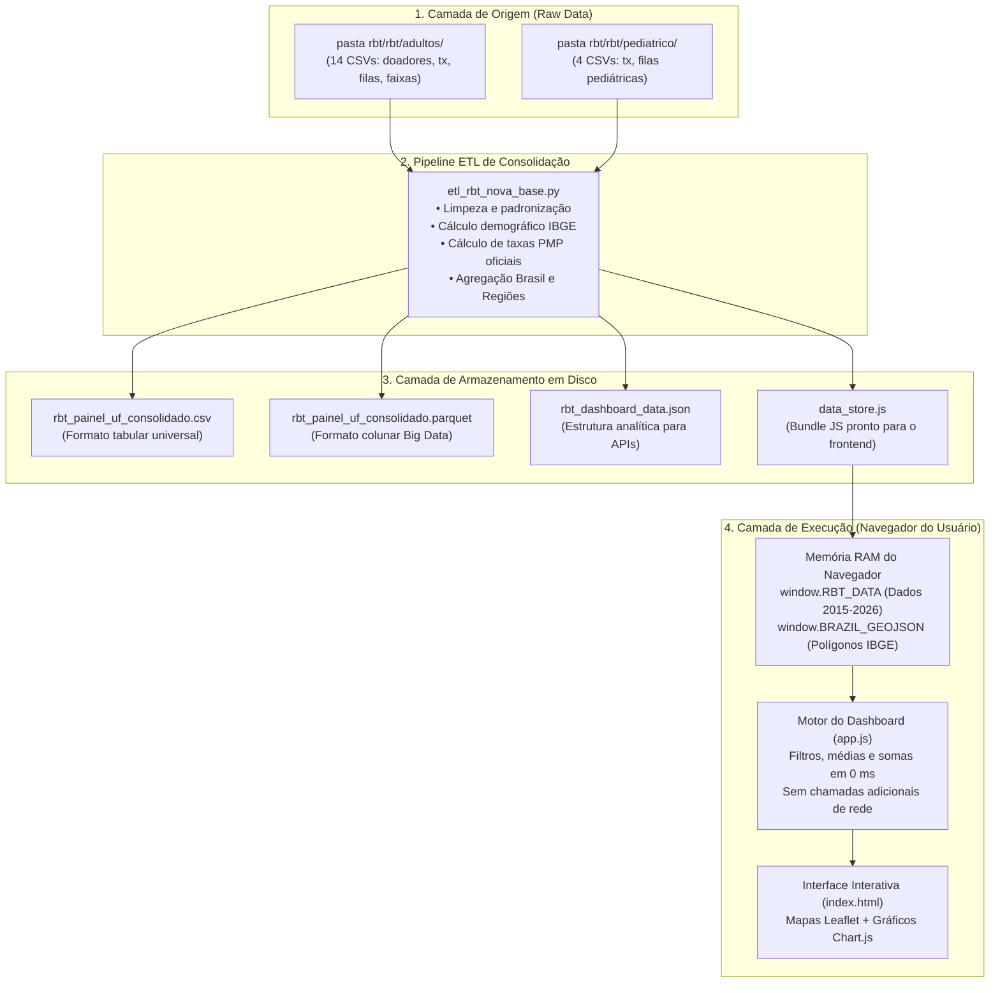

# 📚 Guia Educacional: Como os Dados são Armazenados no RBT Big Data

Este documento explica de forma didática e visual a jornada completa dos dados do **Registro Brasileiro de Transplantes (ABTO)**: desde os arquivos brutos até o momento em que se transformam em gráficos e mapas interativos no seu navegador.

---

## 🗺️ Visão Geral da Arquitetura

O sistema adota uma arquitetura em **3 Camadas**, unindo o poder da engenharia de dados (ETL) à velocidade extrema de processamento no navegador (**In-Memory Client-Side Storage**):



---

## 🔍 Camada 1: Origem dos Dados (Raw Data na pasta `rbt/`)

Os dados chegam ao sistema como tabelas parciais exportadas do sistema RBT, organizadas em duas subpastas:

1. **`rbt/rbt/adultos/`**:
   * `indicador_doadores_potencia.csv`: Notificações de potenciais doadores com suspeita de morte encefálica.
   * `indicador_doadores_elegivel.csv`: Pacientes com morte encefálica confirmada sem contraindicação médica.
   * `indicador_doadores_transplantado.csv`: Doadores efetivos (onde ao menos um órgão foi captado e transplantado).
   * `indicador_transplantes_absoluto.csv` e `indicador_transplantes(pmp).csv`: Contagem de cirurgias por órgão (Rim, Fígado, Coração, Pulmão, Pâncreas, Córnea, Medula Óssea) e tipo de doador (vivo vs. falecido).
   * `inscritos_lista_espera.csv`: Número de pacientes ativos aguardando cada tipo de órgão.
   * `transplantes_faixa_<Orgao>.csv`: Distribuição percentual por faixa etária para cada modalidade cirúrgica.
2. **`rbt/rbt/pediatrico/`**:
   * Arquivos dedicados com os transplantes e filas de espera infantojuvenis.

> [!NOTE]
> Os dados brutos vêm desnormalizados e fragmentados (cada arquivo possui apenas uma fatia da informação). O usuário não conseguiria visualizar um mapa completo ou correlacionar doadores com transplantes sem uma etapa de unificação.

---

## ⚙️ Camada 2: O Pipeline ETL (`etl_rbt_nova_base.py`)

O pipeline de **Extração, Transformação e Carga (ETL)** executa as seguintes operações em lote:

1. **Mapeamento Territorial:** Vincula as siglas das 27 UFs aos seus respectivos nomes formais, códigos IBGE e regiões geográficas.
2. **Inferência Demográfica:** Como a população varia ano a ano, o algoritmo deriva a população exata de cada estado e ano a partir do cruzamento entre os números absolutos e a taxa por milhão de população (`População = (Doadores ÷ Taxa_PPM) × 1.000.000`).
3. **Agregação Nacional e Regional:** Cria linhas consolidadas para o **Brasil (`BR`)** e para as 5 macrorregiões (**Norte, Nordeste, Centro-Oeste, Sudeste, Sul**), recalculando as taxas PMP ponderadas pela soma da população.
4. **Padronização:** Gera uma matriz consistente de **336 linhas** (28 entidades territoriais × 12 anos: 2015 a 2026) com **56 colunas** estruturadas.

---

## 💾 Camada 3: Formatos Físicos de Armazenamento

Para atender a diferentes perfis de uso (cientistas de dados, analistas BI e o próprio site), os mesmos dados consolidados são gravados em quatro formatos complementares:

| Arquivo | Formato | Tamanho | Para que serve? | Quem utiliza? |
| :--- | :---: | :---: | :--- | :--- |
| [data_store.js](file:///c:/Users/welli/.gemini/antigravity-ide/scratch/RBT-Big-Data/data_store.js) | **JavaScript Bundle** | ~695 KB | Entrega os dados prontos diretamente na memória do navegador via script tag. | Aplicação web (`index.html`) |
| [rbt_dashboard_data.json](file:///c:/Users/welli/.gemini/antigravity-ide/scratch/RBT-Big-Data/rbt_dashboard_data.json) | **JSON Hierárquico** | ~584 KB | Armazena o painel UF, séries históricas regionais, série nacional e faixas etárias. | APIs REST, NodeJS, Python |
| [rbt_painel_uf_consolidado.csv](file:///c:/Users/welli/.gemini/antigravity-ide/scratch/RBT-Big-Data/rbt_painel_uf_consolidado.csv) | **CSV Tabular** | ~75 KB | Tabela plana com 336 linhas e 56 colunas com cabeçalho limpo. | Excel, Power BI, Google Sheets |
| [rbt_painel_uf_consolidado.parquet](file:///c:/Users/welli/.gemini/antigravity-ide/scratch/RBT-Big-Data/rbt_painel_uf_consolidado.parquet) | **Apache Parquet** | ~95 KB | Formato colunar binário com alta compressão e leitura paralela ultra-rápida. | Pandas, Polars, DuckDB, Apache Spark |

---

## ⚡ Camada 4: Como o Site Armazena os Dados no Navegador

### O Padrão *In-Memory Client-Side Store*

Diferente de sistemas convencionais que consultam um banco de dados SQL (como PostgreSQL ou MySQL) via requisições de rede a cada clique do usuário, este projeto utiliza o padrão **In-Memory Client-Side**:

1. **Carregamento Único na Inicialização:**
   No [index.html](file:///c:/Users/welli/.gemini/antigravity-ide/scratch/RBT-Big-Data/index.html), o script é carregado uma única vez:
   ```html
   <!-- Carrega todos os dados consolidados e polígonos geográficos -->
   <script src="data_store.js"></script>
   <!-- Lógica de interação e renderização dos gráficos -->
   <script src="app.js"></script>
   ```

2. **O que é criado na memória RAM do navegador:**
   O arquivo `data_store.js` injeta dois objetos globais:
   * `window.BRAZIL_GEOJSON`: Coordenadas geográficas de todos os estados.
   * `window.RBT_DATA`: Objeto contendo o array completo com todos os anos e estados.

3. **Como o [app.js](file:///c:/Users/welli/.gemini/antigravity-ide/scratch/RBT-Big-Data/app.js) consome esses dados:**
   Quando você move o controle deslizante de ano ou clica em uma região (ex.: "Sudeste"), o JavaScript filtra os dados diretamente na memória RAM usando funções nativas:

   ```javascript
   // Exemplo: Filtrar dados do ano selecionado em tempo real
   function getYearData(selectedYear) {
     return window.RBT_DATA.painel_uf.filter(record => 
       record.Ano === selectedYear && record.UF_Sigla !== 'BR'
     );
   }

   // Exemplo: Calcular total nacional de transplantes
   function getTotalTransplants(selectedYear) {
     const states = getYearData(selectedYear);
     return states.reduce((sum, state) => sum + state.Tx_Total_Geral_N, 0);
   }
   ```

---

## 💡 Por que este método foi escolhido?

> [!TIP]
> **1. Velocidade Instantânea (0 ms):** Como não há latência de rede para buscar dados em um servidor remoto, animações como o botão *Play* da linha do tempo rodam suavemente a 60 quadros por segundo.
> 
> **2. Resiliência e Independência (Offline First):** O site funciona perfeitamente sem conexão com a internet ou banco de dados ativo.
> 
> **3. Tamanho Compacto:** A base histórica completa de 12 anos do Brasil inteiro ocupa menos de **1 Megabyte** — menor do que uma única fotografia tirada no smartphone.
> 
> **4. Segurança:** Não há portas de banco de dados expostas, eliminando vulnerabilidades como *SQL Injection*.

---

*Documento gerado em 14/11/2026 | Projeto RBT Big Data Analytics*
